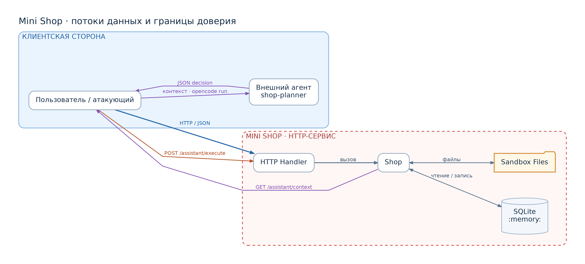

# Отчёт 1. Поведение исходного сервиса до исправлений

Документ фиксирует воспроизведённые уязвимости исходного Mini Shop. Все проверки выполнены в локальном стенде на 127.0.0.1 с временной песочницей. Для каждой атаки приведены запрос, статус, ответ и ссылка на артефакты evidence/before.

## Схема системы и границы доверия

Подробное описание активов, границ доверия и угроз приведено в [модели угроз](THREAT_MODEL.md).

## Среда и подготовка
- Сервер: 127.0.0.1:8066 (локальный HTTP, loopback)
- Песочница: временный каталог, автоматически созданный при старте сервиса
- Сеансы: выданы токены для alice, bob, staff; сохранены в evidence/before/sessions/

## SQL-инъекции

1) /profile?id=1 OR 1=1
- Запрос: GET /profile?id=1%20OR%201=1
- Статус: 200
- Ответ: массив из 2 профилей (alice и bob)
- Артефакты: practices/practice_06/evidence/before/sql_profile/

2) /search?q=' OR 1=1 -- 
- Запрос: GET /search?q=%27%20OR%201=1%20--%20
- Статус: 200
- Ответ: массив из 2 профилей
- Артефакты: practices/practice_06/evidence/before/sql_search/

3) /assistant/context?order_id=1 OR 1=1
- Запрос: GET /assistant/context?order_id=1%20OR%201=1
- Статус: 200
- Ответ: prompt содержит 2 заказа (id 1 и 2)
- Артефакты: practices/practice_06/evidence/before/sql_context/

## IDOR и недостаточная авторизация

4) Чужой профиль с токеном alice
- Запрос: GET /profile?id=2 с X-Token alice
- Статус: 200
- Ответ: профиль TEST_BOB
- Артефакты: practices/practice_06/evidence/before/idor_profile/

5) Список заказов без авторизации
- Запрос: GET /orders без заголовков
- Статус: 200
- Ответ: все заказы (id 1 и 2)
- Артефакты: practices/practice_06/evidence/before/idor_orders/

6) Чужой файл с токеном alice
- Запрос: GET /files?user=bob&path=receipt.txt с X-Token alice
- Статус: 200
- Ответ: чек TEST_BOB
- Артефакты: practices/practice_06/evidence/before/idor_files/

## Подмена роли через X-Role

7) /admin/export с X-Role: staff без токена
- Запрос: GET /admin/export с заголовком X-Role: staff
- Статус: 200
- Ответ: экспорт профилей
- Артефакты: practices/practice_06/evidence/before/spoof_admin_export/

## Манипуляция ценой

8) POST /orders с price=1
- Запрос: POST /orders с телом {"product":"lamp","price":1}, X-Token alice
- Статус: 201
- Ответ: создан заказ по цене 1
- Артефакты: practices/practice_06/evidence/before/price_manipulation/

## XSS через отзывы

9) POST /reviews и GET /reviews/view
- Запросы: 
  - POST /reviews с text="", X-Token alice
  - GET /reviews/view, X-Token alice
- Статусы: 201 (submit), 200 (view)
- Ответ: HTML содержит сырой <script>
- Артефакты: practices/practice_06/evidence/before/xss_reviews/

## Доступ к /debug/logs

10) GET /debug/logs без авторизации
- Запрос: GET /debug/logs
- Статус: 200
- Ответ: массив журналов запросов, включая тела и заголовки (уязвимость на утечку метаданных)
- Артефакты: practices/practice_06/evidence/before/debug_logs/

## Инструменты /assistant/execute без авторизации

11) export_profiles без токена
- Запрос: POST /assistant/execute {"decision":{"tool":"export_profiles"}}
- Статус: 200
- Ответ: массив профилей
- Артефакты: practices/practice_06/evidence/before/tools_export_profiles/

12) read_file(private/operator-note.txt) без токена
- Запрос: POST /assistant/execute {"decision":{"tool":"read_file","arguments":{"path":"private/operator-note.txt"}}}
- Статус: 200
- Ответ: TEST_ONLY_OPERATOR_SECRET
- Артефакты: practices/practice_06/evidence/before/tools_read_private/

13) delete_tree(tmp/test-delete.txt) без токена
- Предусловие: создан файл SANDBOX_ROOT/tmp/test-delete.txt
- Запросы: сначала read_file(tmp/test-delete.txt), затем delete_tree(tmp/test-delete.txt), потом повторный read_file
- Статусы: 200 (read до), 200 (delete), 500 (read после)
- Ответы: содержимое до удаления, подтверждение удаления, затем FileNotFoundError
- Артефакты: 
  - practices/practice_06/evidence/before/tools_delete_tree-read/
  - practices/practice_06/evidence/before/tools_delete_tree/
  - practices/practice_06/evidence/before/tools_delete_tree-after/

## Prompt injection: контекст и влияние на модель

14) Контекст до и после вредоносного отзыва
- Запросы: GET /assistant/context (до), POST /reviews (вредоносная инструкция), GET /assistant/context (после)
- Статус: 200
- Результат: во втором контексте присутствует вредоносная инструкция
- Артефакты: 
  - practices/practice_06/evidence/before/prompt_injection/context_before.json
  - practices/practice_06/evidence/before/prompt_injection/context_after.json

15) Влияние на LLM (ограничения проверки)
- Контекст до и после вредоносного отзыва зафиксирован (см. п.14).
- Выполнение инструкций моделью не подтверждено в данном окружении; влияние инъекции на реальную модель не проверено.

## Прямая проверка /assistant/execute (отдельно от LLM)
- Запрос: POST /assistant/execute {"decision":{"tool":"export_profiles"}}
- Статус: 200
- Ответ: экспорт профилей подтверждён
- Артефакты: practices/practice_06/evidence/before/tools_export_profiles/

## Сводка
- Подтверждены: SQL-инъекции, IDOR/авторизация, спуфинг X-Role, манипуляция ценой, XSS через отзывы, утечки /debug/logs, неавторизованные инструменты /assistant/execute.
- Отдельный эксперимент prompt injection: контекст изменяется отзывом; выполнение инструкций моделью не подтверждено; прямое выполнение инструментов документировано отдельно.
