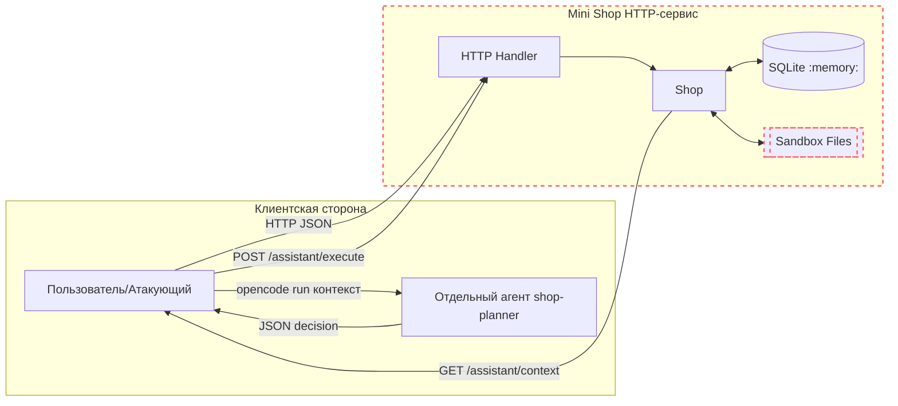

# Модель угроз Mini Shop

Этот документ описывает модель угроз сервиса Mini Shop. Модель покрывает активы, акторов, точки входа, доверенные границы, угрозы, последствия, меры защиты и способы проверки. Сервис изначально содержал демонстрационные уязвимости; они были воспроизведены (REPORT_01) и устранены (REPORT_02).

## Диаграмма потоков данных и границ доверия

Исходная диаграмма Mermaid

Пояснения:
- HTTP-процесс привязан к 127.0.0.1 (локальная петля).
- Файловая песочница (Sandbox) — физическая граница: доступ только внутри временного каталога.
- Агент shop-planner запускается отдельно без инструментов; его решение (JSON) затем передаётся серверу в /assistant/execute.

## Активы
- Данные профилей (TEST_ALICE, TEST_BOB и др.).
- Заказы (owner, product, price).
- Файлы внутри песочницы: чеки клиентов (files/<user>/receipt.txt), служебная записка (private/operator-note.txt).
- Сессионные токены (X-Token).
- Журнал запросов (/debug/logs).

## Акторы
- Клиент (customer) — аутентифицированный пользователь.
- Сотрудник (staff) — аутентифицированный пользователь с ролью staff.
- Неаутентифицированный посетитель (anonymous attacker).
- Агент LLM (shop-planner) — внешний по отношению к серверу, решения передаются вручную.

## Точки входа (HTTP API)
- Публичные: GET /health, GET /products, POST /login.
- Потенциально чувствительные: GET /profile, GET /search, GET /orders, POST /orders, GET /admin/export, GET /files, POST /reviews, GET /reviews/view, GET /debug/logs, GET /assistant/context, POST /assistant/execute.

## Доверенные границы
- Loopback boundary: сервер слушает только 127.0.0.1.
- Sandbox boundary: sandbox.path/ read/ delete_tree ограничивают доступ внутрь временного каталога.
- Авторизация/сессии: ожидается определение владельца и роли на стороне сервера, а не из пользовательских заголовков.

## Угрозы, последствия, меры и проверки

1) SQL-инъекции (tampering, data disclosure)
- Поверхности: /profile?id=..., /search?q=..., /assistant/context?order_id=...
- Последствия: раскрытие всех профилей/заказов, обход фильтров.
- Меры: параметризированные запросы (db.execute с параметрами), whitelisting типов (int), строгая валидация.
- Проверка:
  - До: запросы с "1 OR 1=1" возвращают лишние данные.
  - После: те же запросы не расширяют вывод (400/пустой результат), авто‑тесты на инъекции.

2) IDOR и отсутствие авторизации
- Поверхности: GET /profile (нет проверки владельца), GET /orders (все заказы всем), GET /files?user=... (чужие чеки), GET /debug/logs (без ограничений).
- Последствия: доступ к чужим профилям/заказам/чекам, утечка токенов через журнал.
- Меры: требование валидной сессии (X-Token), сопоставление owner==session.id, staff-политики. Ограничение /files только на собственный каталог.
- Проверка:
  - До: alice получает /profile?id=2 и чужой чек files/bob/receipt.txt.
  - После: 403/401 и фильтрация по session.id; отдельные тесты.

3) Спуфинг роли через X-Role
- Поверхность: GET /admin/export — доверие к заголовку X-Role.
- Последствия: несанкционированный экспорт профилей.
- Меры: игнорировать X-Role из клиента; роль только из server session; проверка staff.
- Проверка:
  - До: X-Role: staff без staff-сессии даёт 200 и профили.
- После: 401 без авторизации, 403 для пользователя без роли staff; доступ разрешён только staff.

4) Манипуляция ценой в заказах
- Поверхность: POST /orders c произвольным price.
- Последствия: покупка по произвольной цене.
- Меры: всегда использовать каталогную цену на сервере; игнорировать входной price.
- Проверка:
  - До: заказ создаётся по цене 1 при передаче price=1.
  - После: цена всегда каталожная; авто‑тест.

5) XSS/контент-инъекция через отзывы и HTML
- Поверхность: POST /reviews + GET /reviews/view.
- Последствия: потенциальная XSS при отображении HTML (в учебном окружении нет браузера, но риск фиксируется).
- Меры: экранирование html (html.escape) либо отдача text/plain/json.
- Проверка:
  - До: вставка <script>… видна сырой в ответе.
  - После: содержимое экранируется/меняется тип ответа.

6) Отсутствие аутентификации/авторизации для /assistant/execute
- Поверхность: POST /assistant/execute без проверки токена и ролей.
- Последствия: выполнение export_profiles/delete_tree/read_file любым лицом; чтение private/operator-note.txt; удаление всех учебных файлов.
- Меры: требовать X-Token; политика по инструментам: export/delete — только staff; read_file — только собственные файлы клиента; валидация путей.
- Проверка:
  - До: вызовы без токена возвращают данные/удаляют дерево.
  - После: 401/403; попытки клиентов — ограничены; отдельные тесты.

7) Утечки через /debug/logs
- Поверхность: свободный доступ к журналу.
- Последствия: раскрытие токенов/заголовков.
- Меры: доступ только для staff; маскирование чувствительных полей.
- Проверка:
  - До: GET /debug/logs доступен всем.
  - После: 401 без авторизации, 403 для пользователя без роли staff; доступ разрешён только staff.

## Prompt injection и инструменты AI-агента (отдельный раздел)

8) Prompt injection через отзывы
- Поверхность: GET /assistant/context включает отзывы как часть промпта; перечисляет доступные инструменты.
- Последствия: модель может сгенерировать JSON-решение с опасным инструментом (например, export_profiles/delete_tree), выходя за задачи клиента.
- Меры:
  - Серверная проверка и авторизация на /assistant/execute независимо от поведения модели.
  - Санация/маркировка контента отзывов (например, указание, что отзывы — недоверенные данные), но ключевое — серверные политики и ограничения инструментов.
- Проверка:
  - До: добавление отзыва с инструкцией приводит к включению текста в контекст (/assistant/context).
  - После: даже при передаче опасного решения через /assistant/execute, сервер блокирует несанкционированные действия согласно ролям и владению.

9) Небезопасное выполнение инструментов
- Поверхность: /assistant/execute принимает решения без проверки токена/роли/владения.
- Последствия: чтение чужих/секретных файлов, экспорт профилей, удаление деревьев внутри песочницы.
- Меры: строгая авторизация и контроль инструментов по ролям и владельцу; белые списки путей.
- Проверка: как в п.6 и п.8; отдельные авто‑тесты до/после.

## Способы проверки (общие)
- Авто‑тесты (python -m unittest) — базовые и добавленные для угроз.
- Скрипты/ручные HTTP‑вызовы для демонстрации до/после.
- Доказательства (evidence) в REPORT_01/REPORT_02: входы/выходы LLM, ответы API, состояние песочницы.
